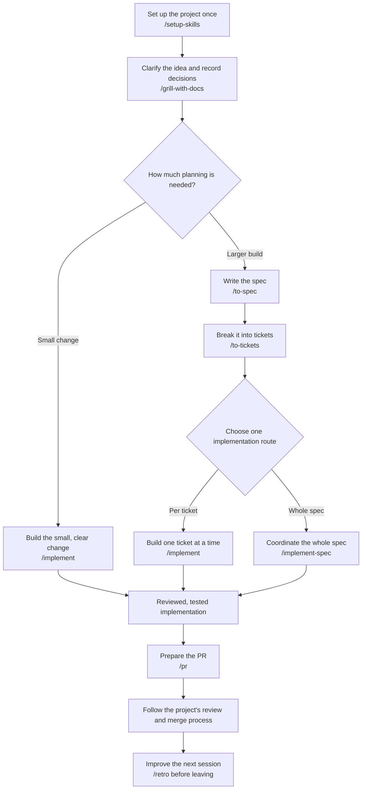

# Engineering skills: from idea to delivery

A practical guide to the skills in this folder. Start with the workflow below, then use the [skill reference](#skill-reference) when you need a different route.

## How to use this guide

Open your coding agent in the **project you want to build**, with these skills installed and available.

### Where to store the skills

Copy all the skill folders in this directory to either your personal skills folder (all projects) or your project's skills folder (one project):

| Agent | Personal | Project |
| --- | --- | --- |
| **Codex** | `~/.agents/skills/` | `<project>/.agents/skills/` |
| **Claude Code** | `~/.claude/skills/` | `<project>/.claude/skills/` |

`~` is your home directory, such as `C:\Users\<username>` on Windows. Keep each skill folder and its contents intact.

### Running the commands

The commands below are messages to your agent, not terminal commands. Run one at a time, answer its questions, and review its output before moving on.

Examples use `/skill-name` notation. Use your agent's skill picker or explicitly ask it to use the named skill if that notation is unavailable. Replace references such as `<spec reference>` with the issue URL, issue number, or local file path the previous step produced.

**Unsure where to start?** 

Ask:

```text
/help-me I am starting a new project to <goal>. Which workflow should I follow?
```

## The basic flow



Research and prototypes are optional detours while clarifying the idea. For an effort whose **planning itself** spans many sessions, start with [wayfinder](#a-project-too-large-to-plan-in-one-session).

### 1. Configure the project once

Use [setup-skills](./setup-skills/SKILL.md) before the first engineering workflow in each project:

```text
/setup-skills
```

It inspects the repo, walks you through configuration, and writes the conventions the other skills need:

- **Issue tracker:** GitHub, GitLab, local Markdown, or your own workflow.
- **Triage labels:** how incoming work is classified.
- **Domain docs:** where shared terminology and architecture decision records (ADRs) belong.

Review the proposed configuration. Setup writes `docs/agents/*.md` and updates the existing `CLAUDE.md` or `AGENTS.md`; if neither exists, it asks which to create. Glossary entries and ADRs are added later as real decisions arise.

**Ready to continue when:** the agent confirms setup is complete and you know where specs and tickets will live. This configures the skills; creating the app scaffold and installing project dependencies are still project work.

> **Command naming in this checkout:** the folder and workflow call this `setup-skills`, but its frontmatter says `name: setup-kills`, its display name is “Setup Matt Pocock Skills,” and several skills refer to `/setup-matt-pocock-skills`. These are inconsistent names for the setup step. If `/setup-skills` is unavailable, select the installed setup skill or explicitly ask the agent to follow [setup-skills/SKILL.md](./setup-skills/SKILL.md).

### 2. Turn the idea into agreed behavior

Use [grill-with-docs](./grill-with-docs/SKILL.md) in your project directory:

```text
/grill-with-docs I want to build <idea> for <users>. The problem is <problem>.
```

The agent interviews you about behavior, constraints, edge cases, and trade-offs. It records agreed domain terms in `GLOSSARY.md` and significant architecture decisions in ADRs as they emerge.

**Ready to continue when:** you agree on what to build, what success looks like, and what is out of scope.

If a question needs more than discussion, take a detour and bring the result back:

| What is missing? | Example command | What comes back |
| --- | --- | --- |
| Facts from documentation or another source | `/research Verify whether <service> supports <requirement>.` | Cited research notes saved in the repo by a background agent. |
| A behavior you need to try | `/prototype Explore how <state model> handles <scenario>.` | A runnable logic demo and a recorded verdict. |
| A design you need to see | `/prototype Show three different layouts for <screen>.` | UI variants you can compare in the browser. |

A prototype answers a design question; allow for production implementation and verification afterward. Keep its branch and findings linked from the eventual implementation issue. Use `/handoff` if the detour moves to another directory or agent; staying in the same session does not require a handoff.

### 3. Choose the right amount of planning

**Small and clear enough for one session?** Continue directly:

```text
/implement Build the behavior we just agreed on.
```

**Large enough to need several tickets or sessions?** Keep the design conversation available and run:

```text
/to-spec
```

[To-spec](./to-spec/SKILL.md) synthesizes the discussion into a published spec. It checks the proposed test seams with you: the public interfaces where tests will observe behavior. It draws on decisions already discussed, so clarify unresolved requirements before this step.

Then run:

```text
/to-tickets <spec reference>
```

[To-tickets](./to-tickets/SKILL.md) proposes small, verifiable slices of working behavior, each with acceptance criteria and its blockers. Approve the breakdown before publication. These tickets are already `ready-for-agent`; they do not need `/triage`.

For a local tracker, the usual outputs are:

```text
.scratch/<feature>/spec.md
.scratch/<feature>/issues/01-<ticket>.md
.scratch/<feature>/issues/02-<ticket>.md
```

**Ready to continue when:** the spec captures the agreed behavior and each ticket says what it delivers, how to verify it, and what must finish first.

### 4. Implement: choose one route

| Route | Use it when | What you do |
| --- | --- | --- |
| [implement](./implement/SKILL.md) | You want to drive one ticket at a time. | Pick a ticket whose blockers are complete, implement it, then repeat in a fresh context. |
| [implement-spec](./implement-spec/SKILL.md) | You want the agent to coordinate the entire ticket graph. | Provide the spec and let it schedule ready tickets across subagents and worktrees on one integration branch. |

**One ticket at a time:**

```text
/implement <ticket reference>
```

`implement` uses `/tdd` where possible at agreed test seams, runs checks and a final full test suite, calls `/code-review`, and commits to the **current branch**. Select the intended working branch before starting. After the ticket is finished, start a fresh context and pass the next unblocked ticket's reference.

**Whole spec:**

```text
/implement-spec <spec reference>
```

`implement-spec` creates an integration branch and coordinates ticket branches and worktrees. Each implementer uses `/tdd`; the completed integration branch gets one `/code-review`. The skill fixes findings, handles tracker completion through the configured workflow, and cleans up implementer worktrees. If the workflow uses PRs, it opens a draft after the first merge and marks it ready at the end.

You normally do **not** need to run `/tdd` and `/code-review` again after these commands. Invoke them separately for standalone test-first work or an additional review with a specific comparison point.

### 5. Prepare the change for review and delivery

When you need a PR description, use [pr](./pr/SKILL.md):

```text
/pr Write the PR body for this change using the validation evidence.
```

It structures the description around a concise visual summary, before/after evidence, and the impact and reversibility of merging. The agent can also reach for this skill automatically while writing a PR.

For a separate review of committed changes, specify the base and spec:

```text
/code-review Review changes since main against <spec reference>.
```

`code-review` checks **Standards** and **Spec** separately. It needs a valid comparison ref and a nonempty diff against that ref; supply the actual base branch or commit for your project.

**Ready for delivery when:** acceptance criteria and project checks pass, review findings are resolved, and the evidence is available to reviewers. Follow your project's process to open or update the PR, merge, and release. These skills do not define a universal deployment command.

### 6. Improve the next session

Run [retro](./retro/SKILL.md) while the implementation session is still available:

```text
/retro
```

It suggests improvements to the agent's environment: navigation, automated checks, coding standards, instructions, and tooling. Review the suggestions and choose what to adopt. If you already left the session, point it at that session's log.

## Other starting points

### A project too large to plan in one session

Use [wayfinder](./wayfinder/SKILL.md) when you cannot yet see the route to the goal:

```text
/wayfinder Plan <large goal>; we still need to resolve <major unknowns>.
```

The first session creates a map and decision tickets. In later sessions, continue with the map reference:

```text
/wayfinder <map reference>
```

Each session resolves one decision ticket, except research tickets, which can run in parallel. Once the route is clear, bring the map and linked decisions into `/to-spec`, then `/to-tickets`, then your chosen implementation route.

Choose `wayfinder` for unresolved planning across sessions. Choose `implement-spec` when the plan and tickets are already clear and you want coordinated execution.

### Incoming bugs and feature requests

```text
/triage Show me what needs my attention.
/triage Let's look at <issue reference>.
```

[Triage](./triage/SKILL.md) verifies incoming requests and helps you decide whether they need more information, are ready for implementation, require a human, or should be closed. Once an issue has an agent-ready brief, use `/implement <issue reference>`.

For a difficult bug or performance regression you are investigating directly:

```text
/diagnosing-bugs Investigate <symptom> using <reproduction details>.
```

[Diagnosing-bugs](./diagnosing-bugs/SKILL.md) establishes a repeatable failure signal, narrows the cause, fixes it, and adds a regression test where a suitable test seam exists. Run `/retro` afterward to identify prevention opportunities.

### Improving an existing codebase

```text
/improve-codebase-architecture Focus on <area or recurring pain>.
```

[Improve-codebase-architecture](./improve-codebase-architecture/SKILL.md) produces an HTML report of opportunities to simplify interfaces and concentrate behavior. Pick a candidate, work through the design questions, then take the agreed change through the planning and implementation flow above.

## When to keep or reset the conversation

- **Keep the design thread together** through `/grill-with-docs`, `/to-spec`, and `/to-tickets`, so decisions survive into the tickets. For a small build, continue straight into `/implement`.
- **Start fresh between independent tickets** once each completed ticket's work and decisions are saved. `/clear`, where supported by your agent, resets the context; then provide the next ticket reference.
- **Use `/handoff <next task>`** when changing agents or directories, handing work to a colleague, or forking a side task. It writes a portable Markdown file to the OS temp directory, with artifact references and suggested skills for the next session.
- **Use your agent's compaction feature at a phase boundary** if the conversation is becoming too large and relevant context still matters. `/clear` and `/compact` are agent features, not skills in this folder; availability depends on your agent.
- **Run `/retro` before clearing** the session it should examine.

See [Phase boundaries](./help-me/PHASE-BOUNDARIES.md) for the full decision guide.

## Skill reference

**Explicit** skills are started by you. **Automatic or explicit** skills can also be selected by the agent when relevant. The invocation flags live in `SKILL.md` for Claude Code and `agents/openai.yaml` for Codex.

### Explicit skills

| Skill | Reach for it when you want to… |
| --- | --- |
| [help-me](./help-me/SKILL.md) | Find the right skill or workflow. |
| [setup-skills](./setup-skills/SKILL.md) | Configure a project before first use; see the naming note above. |
| [grill-with-docs](./grill-with-docs/SKILL.md) | Clarify an idea while recording terminology and decisions. |
| [wayfinder](./wayfinder/SKILL.md) | Resolve a large effort's unknowns across planning sessions. |
| [to-spec](./to-spec/SKILL.md) | Publish the agreed conversation as a buildable spec. |
| [to-tickets](./to-tickets/SKILL.md) | Split work into verifiable tickets with dependencies. |
| [implement](./implement/SKILL.md) | Build and review a scoped change or ticket, then commit it. |
| [implement-spec](./implement-spec/SKILL.md) | Coordinate a whole spec's tickets on an integration branch. |
| [triage](./triage/SKILL.md) | Evaluate incoming issues and prepare implementation briefs. |
| [improve-codebase-architecture](./improve-codebase-architecture/SKILL.md) | Find and explore architectural improvements. |
| [handoff](./handoff/SKILL.md) | Carry context to another agent, directory, or colleague. |
| [retro](./retro/SKILL.md) | Identify improvements to the coding environment after a session. |
| [chief-of-staff](./chief-of-staff/SKILL.md) | Coordinate a long-running goal through subagents in one session; an advanced alternative to driving each task yourself. |

### Automatic or explicit skills

| Skill | Reach for it when you want to… |
| --- | --- |
| [grilling](./grilling/SKILL.md) | Stress-test a decision through an interview, without the documentation wrapper. |
| [domain-modeling](./domain-modeling/SKILL.md) | Sharpen domain terms and record significant decisions. |
| [research](./research/SKILL.md) | Delegate reading to a background agent and save cited findings. |
| [prototype](./prototype/SKILL.md) | Try logic or compare UI designs before committing to an approach. |
| [codebase-design](./codebase-design/SKILL.md) | Design module interfaces and test seams using shared vocabulary. |
| [tdd](./tdd/SKILL.md) | Build a concrete behavior one failing-test/passing-implementation slice at a time. |
| [diagnosing-bugs](./diagnosing-bugs/SKILL.md) | Investigate a difficult bug or performance regression systematically. |
| [code-review](./code-review/SKILL.md) | Review committed changes against coding standards and a spec. |
| [pr](./pr/SKILL.md) | Write a PR body with evidence and merge impact. |
| [wizard](./wizard/SKILL.md) | Generate a Bash script for setup or cutover steps only a human can perform. |
| [writing-for-agents](./writing-for-agents/SKILL.md) | Write skills and instructions that agents can follow reliably. |

This guide covers the 24 skills present in this folder.
